# CYMA-1

A playable Chladni plate: original firmware for the M-VAVE FM-1 pocket synth.


*The boot, from power-on: the sand springs into the credit as Team EG's bronze bell rings, holds, bursts into the
title, then flows into the sand table. Rendered by the same C code that runs on the FM-1.
[Watch it with its sound](media/boot-intro.mp4).*

**Runs on a real FM-1** since 2026-10-29. The current release is **v1.1.3** ([what's new](#whats-new-v11-to-v113),
[status](#status-and-safety)).

Each key strikes, bows or rains on a virtual metal plate. The sand on the 240×240 screen settles into the nodal figure you hear, because the picture and the sound come from the same modal simulation:

- key pressure bows harder;
- SELECT morphs the plate from a circle through hexagon, star, guitar and bar;
- SEQ turns the keybed itself into the plate.

## What's new: v1.1 to v1.1.3

- **No more crackle on big bowed chords** (v1.1). On the first FM-1, an 8-key chord on 21 AETHER pushed the LOAD meter
  to 90–95 % and crackled, because the chip runs CYMA-1's audio about 1.2–1.6× slower than the emulator counts.
  - A CPU governor now lets at most two notes bow at once. A melody still hands the bow to each new note.
  - When the chip runs short, released tails fade early.
  - The hottest render loops moved into RAM.
  - On the unit, held AETHER chords now barely move the meter.
- **Tighter MIDI timing** (v1.1.1). With no computer attached (on battery, or on a charger), the platform retried USB
  once a second and held up the keys, MIDI and the screen for 29–41 ms each time.
  - The [Team EG platform](platform/README.md) makes that retry non-blocking.
  - In the fm1-emu chip emulator, MIDI-to-sound p90 went from **39.9 ms to 7.4 ms**, with no dropouts.
  - Plugging the cable back in still reconnects, as tested on the unit.
- **Team EG's sonic logo** (v1.1.1). At every boot the engine itself plays a bronze bell: a soft E, a full G (Team
  EG's letters), then a quick flick as the sand locks into the credit.
  - It is played live, not from a recording, and rings out by itself in about 2 s, at MASTER's level.
  - It never touches your sound, and any key, button, knob or MIDI note stops it.
  - **BOOT SOUND on or off:** on the GLOBAL page, hold **GLO** for half a second. It is saved with your settings.
  - The browser plays it too.
- **Time to read the credit and the title** (v1.1.1, v1.1.2). The TEAM EG & LIZARD_MAN credit holds about 4 s, and the
  CYMA-1 title and tagline over 3 s. Any key, button or knob skips to the plate.
- **Two fixes from the first field test** (v1.1.3), both found on the unit running v1.1.2:
  - With MASTER at zero, the boot bell played a short burst. The platform started the volume at half and took about
    0.25 s to reach the knob. It now reads MASTER before the audio starts.
  - After the splash, the screen cut from the sand to the last view used (MESH, there). Every boot now lands on the
    sand table, so the splash's sand flows straight into it. EDIT still reaches FIELD and MESH.
- **Layer B with a tap** (v1.1). Tap the button of the page you are on to latch its layer B. Tap it again, or tap SEL,
  to go back. Holding SEL still works.

Every change, version by version: [CHANGELOG.md](CHANGELOG.md).

## Screens

These are frames of the real 240×240 device UI, rendered by the same C code that runs on the FM-1 (the browser build and the hardware draw identical pixels).

| | | |
|---|---|---|
| 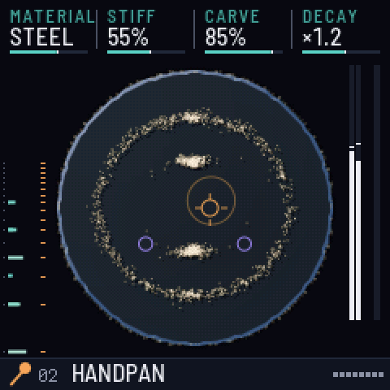 | 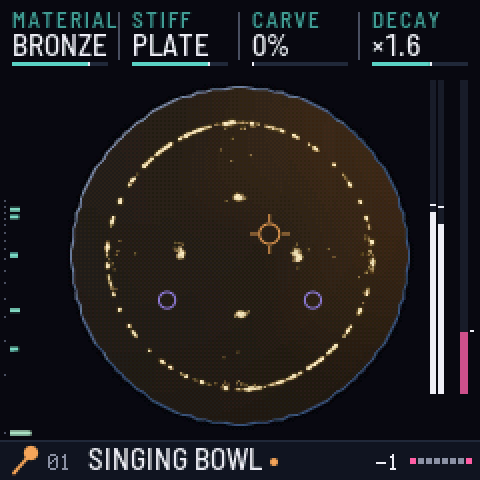 | 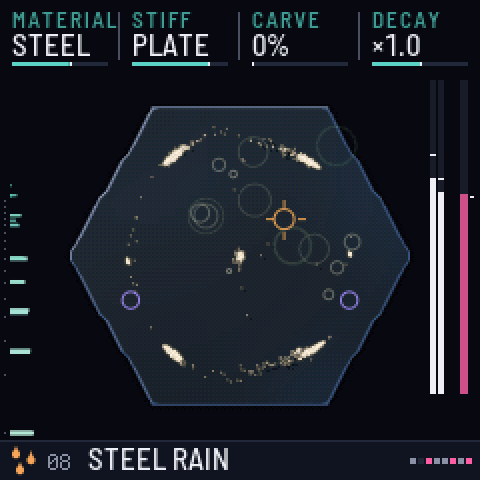 |
| **02 HANDPAN**: sand on the nodal rings of a steel plate | **01 SINGING BOWL**: pressing harder bows harder | **04 STEEL RAIN**: the rain exciter |

| Morphing the plate from circle to star | Steel rain swells |
|---|---|
| 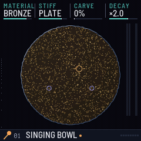 | 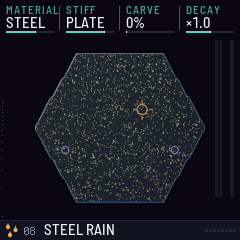 |

[Every plate shape and its first eight vibration patterns](media/plates-and-modes.png) is the reference sheet the engine is checked against: the sand lands on the white nodal lines.

### Three ways to see the sound (EDIT)

Press **EDIT** to switch between three views of the same vibration. All three read the same mode tables and energies as the audio engine, so what you see is what you hear.

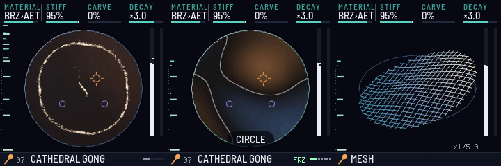

- **SAND:** the grains are thrown off the moving parts of the plate and settle on the nodal lines, as in Chladni's own experiment.
- **FIELD:** the plate's live displacement. One half of each vibration pattern glows warm and the other cool, and the nodal lines, where the plate stands still, are drawn in ink.
- **MESH:** the plate as a slowly turning 3-D wireframe lifted by the vibration, slowed down so the eye can follow it. The `x1/370` tag is the slow-motion factor.

| FIELD: circle to star | MESH: handpan groove | One gong, three views |
|---|---|---|
| 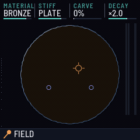 | 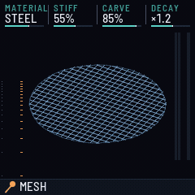 | 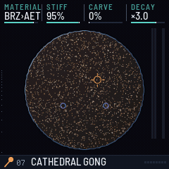 |

### Two colour themes (GLOBAL › THEME)

To switch: press **GLO**, then **tap GLO again** to latch the GLOBAL page's layer B, and **turn K1**. (Or hold **SEL**, Shift in the browser, and turn K1 while holding it.) The theme stays as you leave it; it is saved with your settings.

**CYMATIC** is the default. **PHOSPHOR** redraws everything, including the sand, the field, the mesh and the plate marks, in the tones of a green CRT.

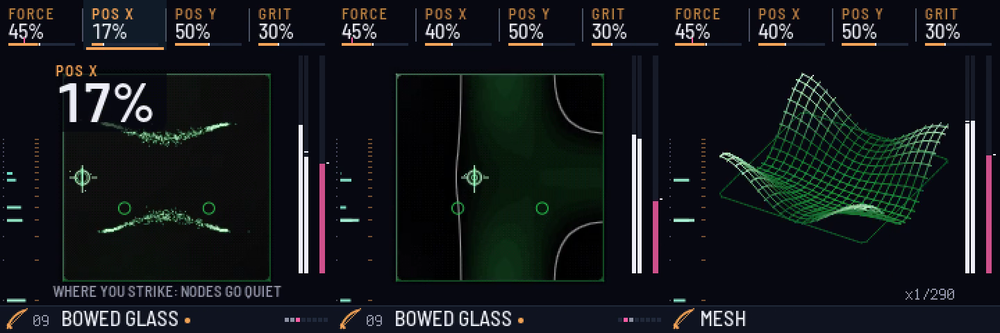

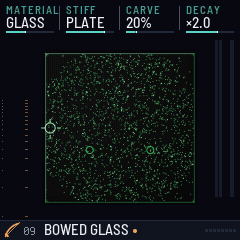

## What's a Chladni plate?

In 1787 the physicist and musician Ernst Chladni scattered sand on a thin brass plate and drew a violin bow along its edge. The plate rang, and the sand jumped into a sharp geometric figure.

A vibrating plate doesn't move everywhere at once. Some regions swing hard while certain lines stay perfectly still (the *nodal lines*). The sand is thrown off the moving parts and piles up on the still lines, so the figure is the shape of the sound. Every note draws its own figure.

Why it's worth a look:

- It makes sound visible.
- Napoleon saw it in 1808 and backed a prize for explaining it. Sophie Germain won it in 1816 with work that helped found the theory of how solid materials vibrate.
- Violin and guitar makers still read Chladni figures on glitter-dusted top plates to carve them until they ring right.
- It's the same experiment as today's "cymatics" videos.

CYMA-1 makes it playable:

- The picture and the sound come from the same simulation of the plate's vibration patterns.
- Morphing the plate changes the figure and the overtones together.
- Pressing harder bows harder.

The plates are Chladni-like rather than laboratory-exact: they are modelled as stiffened membranes.

## Play it

The browser version is in `docs/`. It is the same C code as the FM-1 firmware, compiled to WebAssembly.

To play it locally in Chrome, where Web MIDI works too:

```sh
cd docs && python3 -m http.server 8137
# then open http://localhost:8137
```

Or use `python3 instrument/tools/cyma_local.py` after a local web build (see `instrument/BUILDING.md`).

To play:

- **Keys:** the letter keys in the Ableton layout (A = C4).
- **Lean in:** hold Space.
- **Shape:** ← →.
- **Exciter:** [ ].
- **Presets:** ↑ ↓.
- **Big screen:** B.
- **Sounds** (below the instrument): save, restore, export and share your sounds.
- **Capture:** saves the last 60 s as 24-bit WAV + MIDI.

## Layout

| Path | What |
|---|---|
| `instrument/` | The CYMA-1 app (MPL-2.0): C engine (`src/`), UI (`ui/`), browser page (`web/emu/`), tests and tools |
| `docs/` | The packaged browser build (static files) |
| `platform/` | The [Team EG platform](platform/README.md): the patches CYMA-1 carries on fm1-base and felucca-bsp, as `git format-patch` files |
| `reference/fm1-base` | [fm1-base](https://github.com/charlesvestal/fm1-base) (MPL-2.0), as a git submodule pinned at upstream `086cd0c`: the platform layer, simulator and build tools that the patches apply to |
| `tools/get_platform.sh` | Builds the platform: the pinned upstream plus the patches, checked, in `platform/fm1-base-teg` |
| `tools/build_device.sh` | Device build in the pinned JieLi toolchain container |
| `tools/make_boot_media.sh` | Renders the boot GIF and MP4 from the host simulator |
| `media/` | Screenshots and animations of the device UI |
| `notes/` | The [install guide](notes/INSTALL.md), the draft text of the [v1.1.3 release](notes/release-v1.1.3.md), the FM-1 hardware atlas and the next release's spec |
| `BUILDING.md`, `CHANGELOG.md` | From a fresh clone to the release's exact package; every release's changes |

## Build

CYMA-1 v1.1.1 and later are built on the **Team EG platform**: upstream fm1-base and felucca-bsp at pinned commits, with
[two small fixes](platform/README.md) as patch files. No other repository is needed.

```sh
tools/get_platform.sh                                         # the pinned upstream + platform/patches -> platform/fm1-base-teg
tools/build_device.sh instrument --no-ble --release 1.1.3     # the device package, in the pinned toolchain container
shasum -a 256 instrument/build/cyma-1-1.1.3.fwsc              # 1c61abd4…0f413d3: the v1.1.3 release, byte for byte

export DYLD_LIBRARY_PATH=/opt/homebrew/lib                    # Pillow + libraqm on macOS, for the fonts
export FM1_BASE="$PWD/platform/fm1-base-teg"
python3 "$FM1_BASE/tools/build.py" instrument --host          # native simulator
python3 "$FM1_BASE/tools/build.py" instrument --web           # browser build
instrument/tools/run_all.sh --device                          # every test and gate, the demos, the web package
```

The toolchain image, the expected output of each step, and how `docs/` and the media are made are in
[BUILDING.md](BUILDING.md). A fresh clone that follows it rebuilds the v1.1.3 package byte for byte. Built on upstream
`reference/fm1-base` instead, the package comes out different and is not the release.

## Status and safety

**Runs on a real FM-1.** Every version is tested in the native simulator, the browser build and the fm1-emu chip
emulator before it goes near hardware. On the FM-1, v1.0 replaced stock V15, and each later release updated the one
before it on the same unit:

| Version | Identity, package sha256 | On the FM-1 | Confirmed there |
|---|---|---|---|
| v1.0 | `FM-1_9400`, `1a3b809f…7fc5` | First install, 2026-10-29 (tag `v1.0-hw`) | The colour screen and its smooth frame rate, all 27 keys, pressure, the CPU meter, saving, and the USB Sounds and backup tools. It also showed the AETHER crackle that v1.1 fixes |
| v1.1 | `FM-1_94010100` | Not installed on its own: it went out as part of v1.1.1 | |
| v1.1.1 | `FM-1_94010101`, `a84d55e1…d3fe` | Installed 2026-10-29, evening | It boots cleanly, and the bell sounds right. Held AETHER chords barely load the CPU: the crackle is gone. After an unplug and replug, USB comes back and the tools answer, so the platform's new USB retry works on the chip. The user sounds on the unit were kept |
| v1.1.2 | `FM-1_94010102`, `1554752c…0e54` | Installed 2026-10-29, evening | The longer credit. The user sounds were kept. It also showed the two field bugs that v1.1.3 fixes |
| **v1.1.3** | `FM-1_94010103`, `1c61abd4…13d3` | **Installed and confirmed 2026-10-29, night** | A silent boot with MASTER at zero, the full bell with the knob up, and every boot landing on the sand table, even after MESH. The user sounds were kept |

- No firmware package (`.fwsc`) is included in this repo. Each release attaches its package, with its sha256. The
  package is also exactly what [BUILDING.md](BUILDING.md) builds.
- To install, update, go back to stock V15 or recover, follow [notes/INSTALL.md](notes/INSTALL.md). It is the route
  every install so far took: from a Mac, with no Transporter dongle. Before a first install of any custom firmware:
  - back up the unit's full flash, twice, and keep three copies;
  - keep the official V15 image for recovery;
  - never install V16.

### Known limits

- **The panel keys are slower than MIDI.** In fm1-emu, key-to-sound p90 is about 20–22 ms (21.8 ms while playing,
  20.4 ms on a held note), against 7.8 ms for MIDI. Most of it is velocity sensing: the key's travel is timed before
  the note can start. These are the 2 red gates of the emulator's 21, and they have been red since v1.0.
- **Bowed chords stay at two notes on the FM-1.** The governor keeps the chip from overrunning. Mallet and rain presets
  play full chords.
- **On 21 AETHER, a MIDI note can wait for the plate.** AETHER's LFO keeps morphing the plate, and each recompute holds
  up the main loop: 12–14 ms at the emulator's stand-in for a slower chip.
- **The first touch during the bell sounds about 15 ms late**: the bell fades out (8.7 ms), then hands the engine
  back. This happens once per boot, and only if you play within the first 2.35 s.
- **BOOT SOUND is a gesture**, not a knob: hold GLO for half a second on the GLOBAL page.
- **Emulator figures are not measurements on the FM-1.** fm1-emu has no cache model, and the real chip runs CYMA-1's
  audio about 1.2–1.6× slower than its counts. The LOAD meter on the unit is the real measure.
- **There is no battery level** on the screen. Charge before you install or save.
- **An install that gets cut off is not protected** (fm1-base's loader). A pulled cable is harmless, but a power cut
  during the write can leave the unit dark or in ROM mode: see [notes/INSTALL.md](notes/INSTALL.md).

## Milestones

| Date | Milestone |
|---|---|
| 2026-10-24 | Built in one night by agent teams. Research covered about 45 community repos and the chip's own documents. A design contest of 5 concepts and 3 judges picked the Chladni plate, 8 agents built the modules in parallel, and an adversarial review confirmed 115 findings (98 fixed, 13 partly fixed) before release. |
| 2026-10-24 | The browser version plays the same C code compiled to WebAssembly. |
| 2026-10-24 | **Sounds**: save, restore, export and share sounds as short codes, and send them to the FM-1 over USB-MIDI. A hardening round followed. |
| 2026-10-28 | **Hardware prep**: a safety re-check of the firmware, a byte-for-byte reproducible rebuild, the Mac recovery tools vetted, and a step-by-step install plan (now the [install guide](notes/INSTALL.md)). |
| 2026-10-28 | **Hardware atlas**: the FM-1 mapped down to the chip, from silicon blocks and all 48 pins to the board, the stock firmware and its protocols. A skeptic agent checked every claim, and 42 earlier community claims were corrected ([notes/FM-1-hardware-atlas.md](notes/FM-1-hardware-atlas.md)). |
| 2026-10-28 | **Next release designed**: VOICE, the talking plate (your voice over USB shapes the plate's resonances), and export as an Ableton instrument ([notes/CYMA-1-voice-spec.md](notes/CYMA-1-voice-spec.md)). |
| 2026-10-29 | **First install on a real FM-1.** A full flash backup was taken from macOS through the chip's ROM mode, with two identical reads; as far as we know, the first report of that route working on an M4 Mac with macOS 26. The install took about 2 minutes. On hardware, the colour screen, the smooth frame rate, all 27 keys, pressure, the CPU meter, saving, and the USB Sounds and backup tools all work. Tag `v1.0-hw`. |
| 2026-10-29 | **v1.1: the crackle fix.** The unit showed bowed AETHER chords at 90–95 % load, crackling: the chip runs the audio 1.2–1.6× slower than the emulator counts. A CPU governor now bows at most two notes at once, and the hot loops run from RAM. The boot gains the TEAM EG & LIZARD_MAN credit. |
| 2026-10-29 | **The Team EG platform.** fm1-base's once-a-second USB retry, with no computer attached, held up keys and MIDI for up to 41 ms. A two-step retry cuts the emulator's MIDI-to-sound p90 from 39.9 to 7.4 ms. |
| 2026-10-29 | **Team EG's sonic logo**: a bronze bell (E, G and a flick), picked from several candidates, played live by the engine at every boot. |
| 2026-10-29 | **v1.1.1 and v1.1.2 on the FM-1.** The boot and the bell, AETHER without the crackle, and USB coming back after a replug, all confirmed on the unit. v1.1.2 holds the credit long enough to read, and showed the first two field bugs. |
| 2026-10-29 | **v1.1.3**: both field bugs fixed the same night. The platform became patch files in this repo, and a fresh clone rebuilds the release byte for byte. Both fixes were confirmed on the unit that night. |

## Credits

- Produced by **Team EG** & **Lizard_Man**.
- Built on [fm1-base](https://github.com/charlesvestal/fm1-base) by Charles Vestal, which builds on Leo Kuroshita's [felucca-bsp](https://github.com/hugelton/felucca-bsp) (MPL-2.0). The Team EG platform is two small patches on top of them (`platform/`, MPL-2.0).
- The device build runs in a toolchain image built from [Optimist](https://github.com/w0ts/optimist)'s Dockerfile.
- Install and recovery from a Mac rely on Melodee's [fm1-recover](https://github.com/keremimo/melodee), [MvaveFM1Unbricker](https://github.com/Quixotic7/MvaveFM1Unbricker) and [M-Flasher](https://github.com/jvitkauskas/m-flasher).
- Fonts: Barlow and Terminus (SIL OFL 1.1).
- CYMA-1 is MPL-2.0.

## Names and logos

The source code is MPL-2.0 (see `LICENSE`). The names **Team EG**, **Lizard_Man** and **CYMA-1**, and their logos and boot artwork, are not licensed under MPL-2.0. Forks are welcome, under a different name, and without suggesting that Team EG or Lizard_Man made or endorse them.
